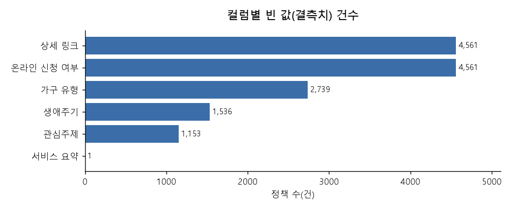
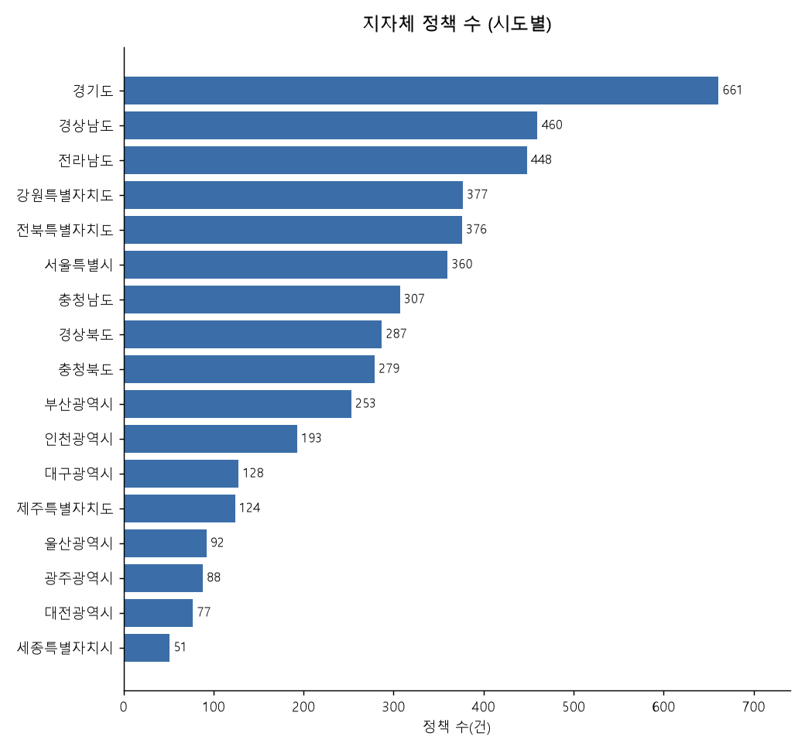
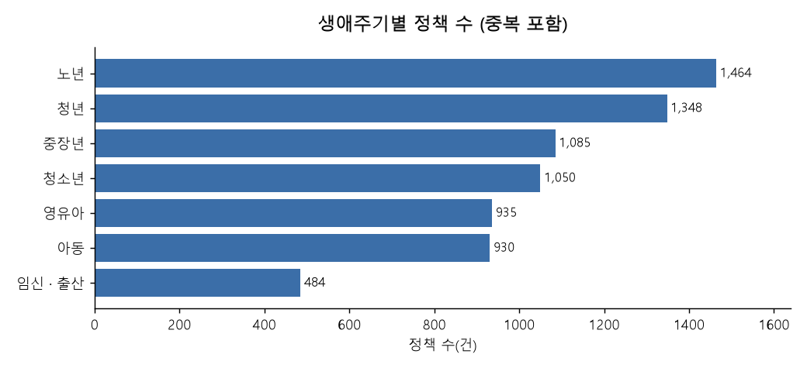
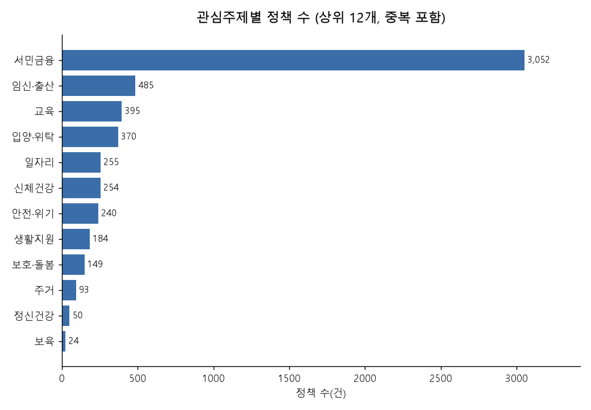
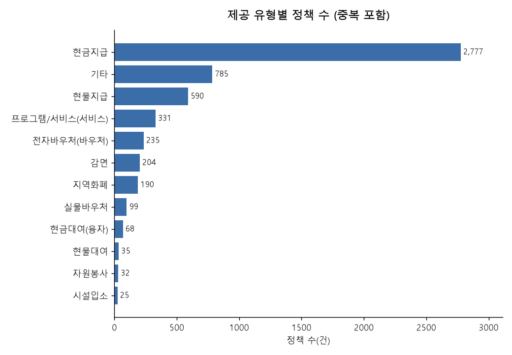

# 복지 정책 데이터 현황

> `python analysis/analyze_policies.py` 로 `seed.sql` 에서 자동 생성한 문서입니다.

## 주요 발견

- 정책의 **91%가 지자체 정책**이지만, 조회수 상위 10개 중 **10개는 중앙부처 정책**입니다. 지자체 정책은 수는 많아도 잘 알려지지 않아, 거주 지역 기반 추천이 필요한 근거가 됩니다.
- 상세 링크·온라인 신청 여부의 빈 값은 모두 지자체 정책입니다 (지자체 4,561건 중 4,561건). 지자체 수집 스크립트(`importLocal.py`)가 이 두 항목을 저장하지 않아 생긴 빈 값으로, 수집 단계의 개선 과제입니다.
- 제공 유형은 328건이 여러 값을 쉼표로 묶어 저장하고 있고 띄어쓰기도 제각각이라, 값을 나눠 정리한 뒤 집계했습니다.

## 1. 데이터 품질 점검

| 항목 | 결과 |
| --- | --- |
| 전체 정책 수 | **5,011건** (중앙부처 450 · 지자체 4,561) |
| 정책 ID 중복 | 0건 |
| 상세 정보(servdetail) 연결 | 5,011건 연결 · 0건 미연결 |

**컬럼별 빈 값(결측치)**

| 컬럼 | 빈 값 | 비율 |
| --- | ---: | ---: |
| 상세 링크 | 4,561 | 91.0% |
| 온라인 신청 여부 | 4,561 | 91.0% |
| 가구 유형 | 2,739 | 54.7% |
| 생애주기 | 1,536 | 30.7% |
| 관심주제 | 1,153 | 23.0% |
| 서비스 요약 | 1 | 0.0% |
| 소관 부처/기관 | 0 | 0.0% |
| 지원 주기 | 0 | 0.0% |
| 제공 유형 | 0 | 0.0% |

## 2. 출처 · 지역

| 출처 | 건수 | 비율 |
| --- | ---: | ---: |
| 지자체 | 4,561 | 91.0% |
| 중앙부처 | 450 | 9.0% |

## 3. 정책 특성

하나의 정책이 여러 생애주기·주제에 해당할 수 있어 합계는 전체 건수보다 큽니다.

**가구 유형 (중복 포함)**

| 가구 유형 | 건수 | 비율 |
| --- | ---: | ---: |
| 저소득 | 943 | 18.8% |
| 장애인 | 794 | 15.8% |
| 보훈대상자 | 508 | 10.1% |
| 한부모·조손 | 459 | 9.2% |
| 다문화·탈북민 | 196 | 3.9% |
| 다자녀 | 186 | 3.7% |

**지원 주기**

| 지원 주기 | 건수 | 비율 |
| --- | ---: | ---: |
| 1회성 | 1,658 | 33.1% |
| 월 | 1,510 | 30.1% |
| 수시 | 701 | 14.0% |
| 년 | 605 | 12.1% |
| 분기 | 269 | 5.4% |
| 반기 | 181 | 3.6% |
| 주 | 79 | 1.6% |
| 기타 | 6 | 0.1% |
| 부정기 | 2 | 0.0% |

## 4. 조회수 상위 10개 정책

| 순위 | 정책명 | 출처 | 조회수 |
| ---: | --- | --- | ---: |
| 1 | 청년내일저축계좌 | 중앙부처 | 12,617,431 |
| 2 | 청년월세 지원사업 | 중앙부처 | 12,100,094 |
| 3 | 장애인연금 | 중앙부처 | 5,504,006 |
| 4 | 주거급여(맞춤형 급여) | 중앙부처 | 4,363,508 |
| 5 | 에너지바우처 | 중앙부처 | 3,213,089 |
| 6 | 영유아보육료 지원 | 중앙부처 | 2,570,905 |
| 7 | 이동통신요금감면 | 중앙부처 | 1,958,807 |
| 8 | 기초연금 | 중앙부처 | 1,888,387 |
| 9 | 유아학비 지원(3~5세 누리과정 지원) | 중앙부처 | 1,833,524 |
| 10 | 산모·신생아 건강관리 지원사업 | 중앙부처 | 1,718,032 |
